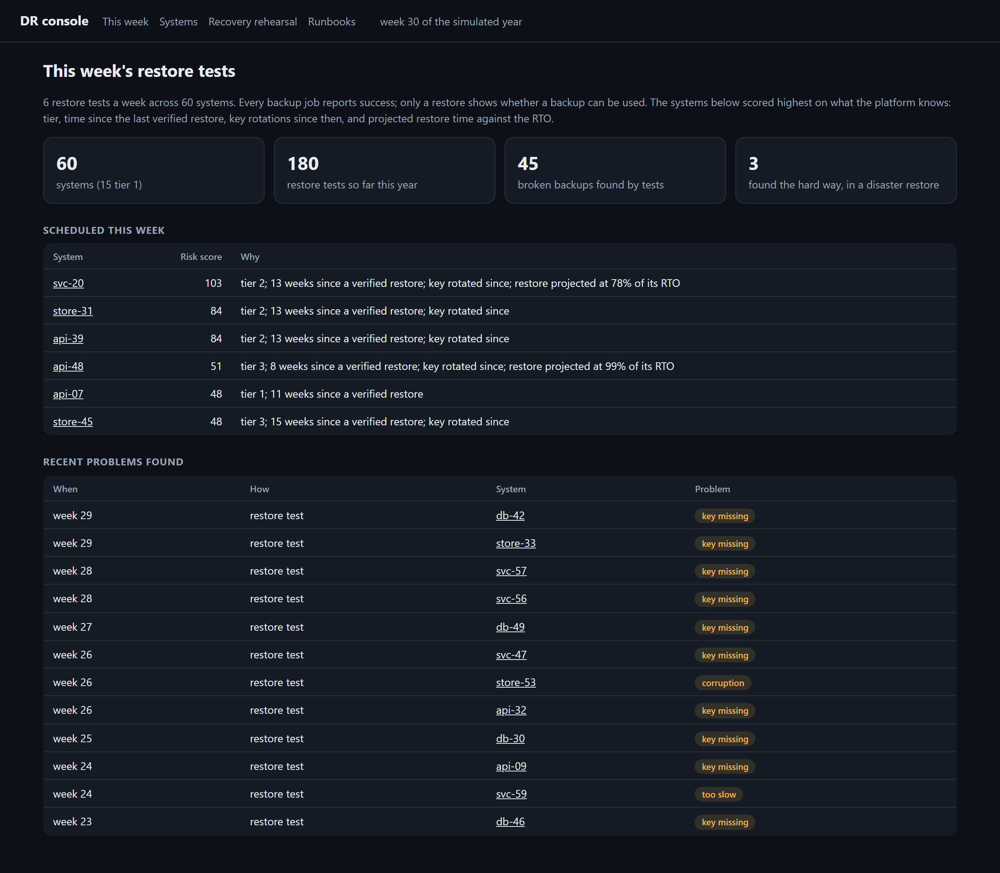
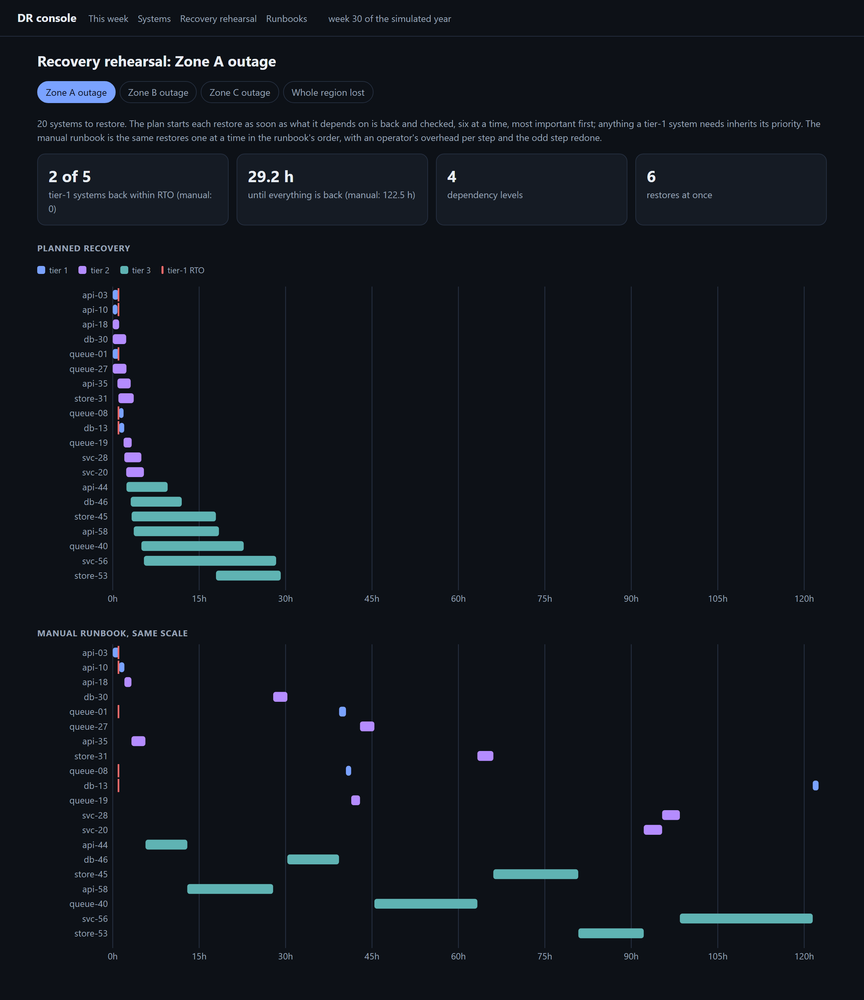
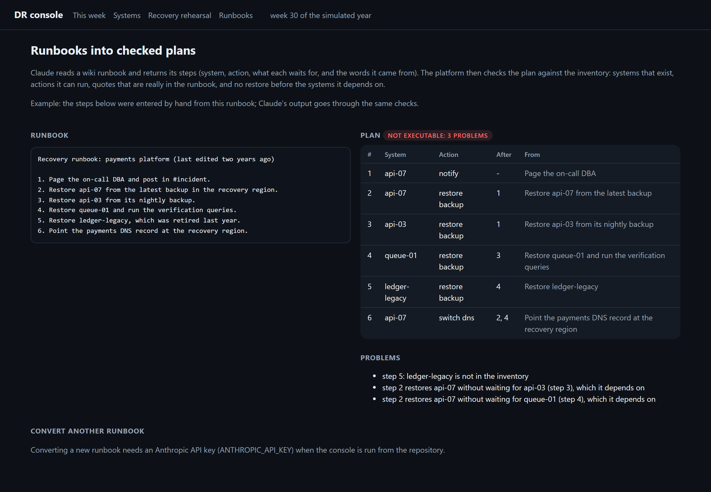

# Automated Disaster Recovery

[](https://github.com/codeROCK-IZZY/disaster-recovery-automation/actions/workflows/ci.yml)


Every backup job says "succeeded". That says nothing about whether the backup can be restored. A key rotation leaves
the copy in the recovery region unreadable. A retention change deletes the base backup that the incrementals need.
Corrupt blocks creep in. Data grows until a full restore takes longer than the business can wait. Teams usually find
out during the disaster.

This platform does three things about it:

- **Proves backups by restoring them.** There is only room for a few restore tests a week, so they go to the
  systems where a silent failure is most likely and would hurt most.
- **Orchestrates the recovery.** When a zone or region goes, restores run in dependency order, several at once, most
  important first. Each one is checked before anything that needs it starts.
- **Turns old wiki runbooks into checked plans.** Claude reads the runbook. Code then checks the plan against the
  inventory and the dependency graph before anyone relies on it.



## Results

`drp evaluate --gate` simulates a year of 60-system estates with 6 restore tests a week. Over the year, backups
silently break in four ways (corruption, a missing key after a rotation, a broken backup chain, a restore outgrowing
its RTO), and region outages each force a third of the systems to be restored. The risk weights and the scheduling
design were chosen on 10 tuning estates. The numbers below are from **30 held-out estates** (2,918 silent failures
and 187 disasters):

| Restore testing (held-out) | Days a broken backup goes unnoticed | Clean restores in disasters | RPO breaches | RTO breaches | Tier-1 restores that failed |
|---|---:|---:|---:|---:|---:|
| Trust the job status | 95.3 | 2,434 of 3,740 | 397 | 1,056 | 331 |
| Random restore tests | 39.8 | 3,094 | 177 | 505 | 172 |
| Round robin (oldest test first) | 28.8 | 3,222 | 144 | 389 | 127 |
| **Risk-based (this platform)** | **26.5** | **3,276** | **135** | **342** | **80** |

| Recovery (held-out, 942 tier-1 restores) | Tier-1 systems back within RTO | Median time until everything is back |
|---|---:|---:|
| Manual runbook (one step at a time, in the runbook's order) | 8.5% | 132.9 h |
| **Orchestrated (dependency order, 6 at once, tier-1 first)** | **65.4%** | **31.9 h** |

What the numbers show:

- **Any restore testing beats trusting the job status by a wide margin.** Broken backups go unnoticed for about a
  month instead of three, and failed tier-1 restores fall by half even with random tests.
- **Choosing tests by risk matters most for tier 1.** It finds broken backups only slightly sooner than round robin
  on average (26.5 against 28.8 days). But it puts the tests where failures cost most: 80 failed tier-1 restores
  against 127. Most of the gain comes from testing soon after a key rotation (see [ADR 1](docs/adr/0001-risk-based-restore-tests.md)).
- **It is not always better.** A held-back estate of a different shape had 120 systems, 8 tests a week, twice the
  corruption and broken chains, and fewer key failures. There, risk-based testing only ties round robin on tier 1
  (80 against 86 failures) and does *worse* on data loss (202 RPO breaches against 178). The score favours key
  rotations and restore times, so when corruption dominates, plain round robin is as good. Full table:
  [eval/reports/report.md](eval/reports/report.md).
- **Orchestration is most of the recovery story.** Even orchestrated, a third of tier-1 systems miss their RTO.
  Their full restore is close to the target, or they wait on a dependency. That is a sizing problem for the backups
  (snapshots, warm standbys), not an ordering problem: priority scheduling met the same share of targets as
  whole-wave recovery on the tuning estates, and only made the whole recovery faster ([ADR 2](docs/adr/0002-recovery-orchestration.md)).



## How it works

```
weekly:   score = tier weight x weeks since a verified restore x (1 + 2 if the key rotated since)
                  x (1 + 3 x how far the projected restore time is past 70% of the RTO)
          ─► restore-test the top N; anything found is fixed, and the system's clock resets

disaster: systems hit ─► tier-1 priority pushed down to what tier-1 systems depend on
          ─► start each restore when its dependencies are back and checked, N at a time, most important first
          ─► Gantt against each system's RTO

runbook:  wiki text ─► Claude (strict tool: system, action, waits-for, the words it came from)
          ─► checks: system exists · action is one the platform runs · waits-for steps exist · quote is really in
             the runbook · no restore before the systems it depends on (from the dependency graph)
          ─► executable, or a list of problems for a person to fix
```

- **Restore tests** (`verify.py`). The score uses only what a platform knows: tiers, rotation logs, measured data
  size and restore throughput. It never uses the hidden state of the backups.
- **Orchestration** (`orchestrate.py`). Each restore is followed by an automatic check (checksums and a smoke test)
  before its dependants start. The manual baseline runs the same restores one by one in the runbook's order, with an
  operator's overhead per step and a chance a step is redone.
- **Runbooks** (`runbook.py`). Claude (`claude-opus-5-5`, low effort, refusal fallbacks) extracts the steps. It is
  never trusted to get the order right: the dependency graph decides that. See [ADR 3](docs/adr/0003-runbooks-with-claude.md).



Decisions: [docs/adr](docs/adr). Gaps: [docs/known-limitations.md](docs/known-limitations.md).

## Run it

```bash
python -m venv .venv && . .venv/bin/activate
pip install -e ".[dev]"

drp schedule                  # this week's restore tests in the demo estate, and why
drp plan                      # a recovery plan for a zone outage (or: drp plan db-13 api-03 ...)
drp serve                     # the DR console on http://127.0.0.1:8000
drp runbook my-runbook.txt    # needs ANTHROPIC_API_KEY
drp evaluate --gate           # eval/reports/report.{md,json,html}
pytest
```

API: `GET /api/schedule`, `POST /api/plan {"systems": [...]}` returns each restore's start, end and whether it is
within its RTO. `POST /api/runbook {"text"}` returns the checked plan (needs `ANTHROPIC_API_KEY`).

## Tests and CI

Tests cover:

- the simulated estate: deterministic, every failure mode, restores outgrowing their RTO at the right week;
- equal test capacity for every policy, the parts of the risk score, and risk-based tests beating the job status;
- recovery plans that respect dependencies and parallelism, are never slower than wave-by-wave recovery and beat
  the manual runbook;
- runbook checks: unknown systems, unknown actions, missing steps, invented quotes, restores before their
  dependencies, and waits that hold only through another step;
- runbook conversion **through the real Anthropic SDK** with canned responses: the request shape, a clean plan, a
  plan in the wrong order, a refusal;
- the console's pages and API, and the command line.

CI runs ruff, `mypy --strict`, the tests on Python 3.12 and 3.13, the full evaluation gate, the container serving
the console, and a gitleaks scan of the full history.

## License

MIT
